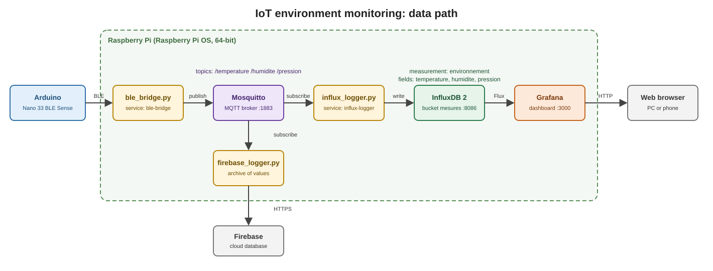
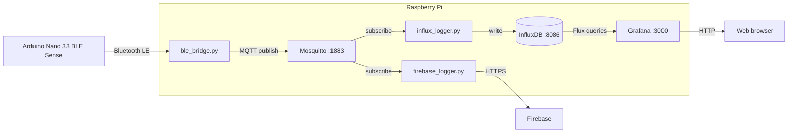

# IoT Environment Monitoring: Arduino, Raspberry Pi, InfluxDB and Grafana

An Arduino Nano 33 BLE Sense measures temperature, humidity and pressure and sends the values over Bluetooth Low Energy to a Raspberry Pi. The Pi publishes them on an MQTT broker, stores them in a time-series database (InfluxDB) and shows them live on a Grafana dashboard. Everything on the Pi starts automatically at boot.





## Components

| Component | Role |
|---|---|
| Arduino Nano 33 BLE Sense | Reads the sensors and sends the values over Bluetooth LE |
| `ble_bridge.py` | Connects to the Arduino over BLE and publishes each value on MQTT |
| Mosquitto | MQTT broker on port 1883, the central hub between all scripts |
| `influx_logger.py` | Subscribes to the MQTT topics and writes every value into InfluxDB |
| InfluxDB 2 | Time-series database (organization `iot`, bucket `mesures`) |
| Grafana | Live dashboard `Environnement` with one chart per measurement |
| `firebase_logger.py` | Optional: archives timestamped values in Firebase |

## MQTT topics and data model

| MQTT topic | InfluxDB field |
|---|---|
| `/temperature` | `temperature` |
| `/humidite` | `humidite` |
| `/pression` | `pression` |

All points are stored in the measurement `environnement` with the tag `capteur=nano33-ble-sense`. InfluxDB adds the timestamp when the value arrives.

## Repository content

```
iot_bridge/
├── ble_bridge.py        BLE to MQTT bridge
├── bridge.py            serial to MQTT bridge (USB alternative)
├── influx_logger.py     MQTT to InfluxDB logger
├── firebase_logger.py   MQTT to Firebase archive (optional)
├── firebase_test.py     Firebase connection test
├── systemd/             service files (ble-bridge, influx-logger)
├── architecture.svg     architecture diagram
├── REPORT.md            short project report
├── COMMANDS.txt         commands with explanations
└── README.md            this file
```

## Requirements

- Raspberry Pi with a 64-bit OS (`dpkg --print-architecture` prints `arm64`), at least 2 GB of RAM recommended
- Arduino Nano 33 BLE Sense running the sensor sketch (advertises the values over BLE)
- Mosquitto, InfluxDB 2.x, Grafana
- Python 3 with `paho-mqtt` and `influxdb-client`

## Quick start

The complete step-by-step commands, with an explanation of each one, are in [`COMMANDS.txt`](COMMANDS.txt). In short:

1. Install Mosquitto, InfluxDB and Grafana on the Pi.
2. In InfluxDB, create the organization `iot` and the bucket `mesures`.
3. Create two API tokens: one **write-only** token on `mesures` for the logger, and one **read-only** token for Grafana.
4. Save the logger token in `~/secrets/influx-token` (outside the repository) and run `chmod 600` on it.
5. Install the Python libraries: `python3 -m pip install paho-mqtt influxdb-client --break-system-packages`
6. Copy `systemd/*.service` to `/etc/systemd/system/` and enable both services.
7. In Grafana, add InfluxDB as a data source (Flux, URL `http://localhost:8086`, organization `iot`, bucket `mesures`, read-only token) and create the dashboard.

## How to use the project

1. Power the Arduino and keep it within Bluetooth range of the Pi.
2. Power the Pi. The services `ble-bridge` and `influx-logger` start by themselves.
3. Open `http://<Pi_IP>:3000` in a browser and open the dashboard **Environnement**.
4. Choose a time range (for example *Last 15 minutes*) and set auto-refresh to 5 s.
5. Check the system at any time on the Pi:

```bash
sudo systemctl status ble-bridge influx-logger mosquitto influxdb grafana-server --no-pager
mosquitto_sub -h localhost -t "#" -v        # live MQTT messages
```

## Verification

- `mosquitto_sub -h localhost -t "#" -v` prints `/temperature ...`, `/humidite ...`, `/pression ...` lines.
- In the InfluxDB Data Explorer, the bucket `mesures` contains the measurement `environnement` with new points.
- The Grafana dashboard shows three live charts.
- After `sudo reboot`, the data flows again without any manual action.

## Security notes

- **No secret is stored in the repository.** Tokens and the Firebase key live in `~/secrets` on the Pi, and `.gitignore` excludes key files.
- The logger token can only **write** to `mesures`. The Grafana token can only **read** it. If one leaks, the damage stays small.
- InfluxDB shows a token only once, when it is created.
- Change the default Grafana password, and do not expose ports 1883, 8086 and 3000 to the internet.

## Troubleshooting

| Symptom | Likely cause | Fix |
|---|---|---|
| Logger prints `401 Unauthorized` | Token file empty, incomplete or without write permission on `mesures` | Check the token length (88 characters), recreate the token, test with `curl` (see `COMMANDS.txt`) |
| No values in `mosquitto_sub` | BLE bridge not running or Arduino out of range | `sudo systemctl status ble-bridge`, `sudo journalctl -u ble-bridge -n 30` |
| Dashboard empty | Wrong time range, field name or bucket | Set *Last 15 minutes*, check the Flux query |
| Charts stop after closing SSH | Scripts started by hand | Use the systemd services instead |

## Authors

Ichrak Ayadi & Emna ghorbel 
